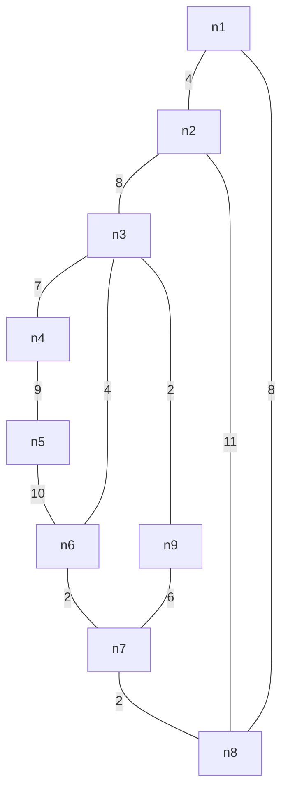
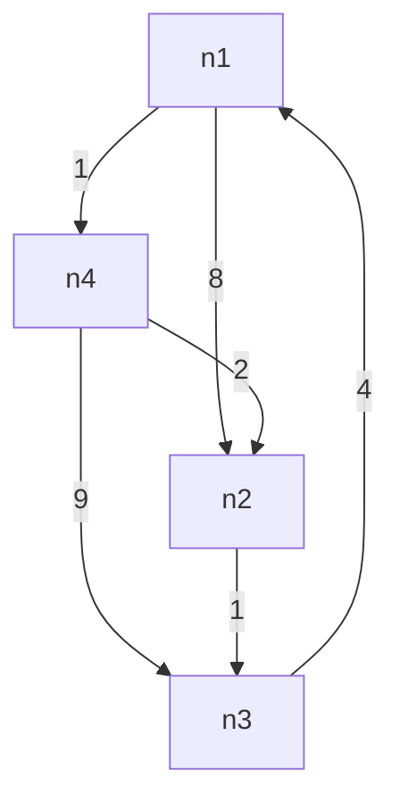

# incourse 1 
1. find minimum spanning tree using prim's algorithm from the following graph

2. why does dijkstra's algorithm fail on negatide weights? with example
3. apply floyd warshall algorithm and find the initial matrix only

4. find the subset of the items to be added in the knapsack such that the profit is maimum. capacity=10

| items         | 1   | 2   | 3   | 4   | 5   |
| ------------- | --- | --- | --- | --- | --- |
| weights in kg | 3   | 3   | 2   | 5   | 1   |
| profits       | 10  | 15  | 10  | 12  | 8   |
