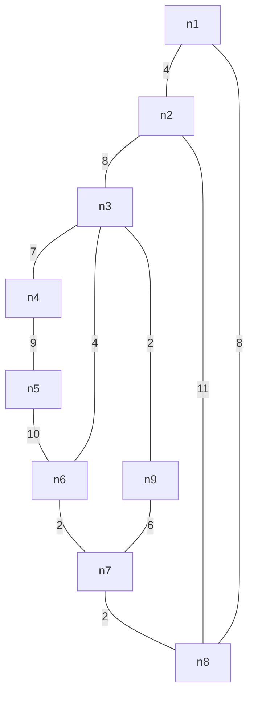
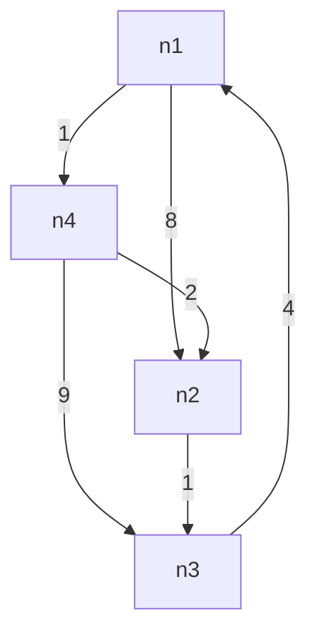
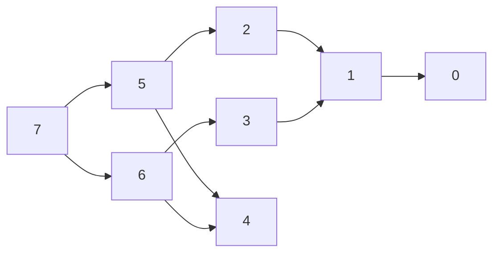
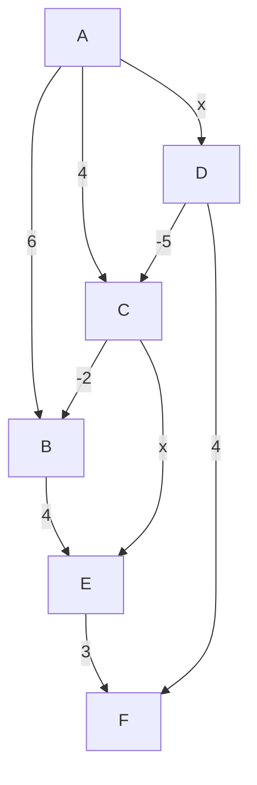
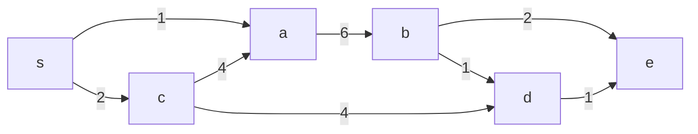

# mec incourse 1 
1. find minimum spanning tree using prim's algorithm from the following graph

2. why does dijkstra's algorithm fail on negatide weights? with example
3. apply floyd warshall algorithm and find the initial matrix only

4. find the subset of the items to be added in the knapsack such that the profit is maimum. capacity=10

| items         | 1   | 2   | 3   | 4   | 5   |
| ------------- | --- | --- | --- | --- | --- |
| weights in kg | 3   | 3   | 2   | 5   | 1   |
| profits       | 10  | 15  | 10  | 12  | 8   |
# mec incourse 2
1. compare dynamic programming with greedy and divide and conquer method
2. x=president and y=providence. longest common subsequence with length
3. solve the following recurrence relation using substitution method: T(n)=T(n/2)+c if n>1. T(n)=1 if n = 1.
# nitter incourse 1
1. define algorithm. key criteria
2. recurrence relation solve
	1. $T(n)=2T(n/2)+n$ where $T(1)=1$ as initial condition (using substitution method)
	2. $T(n)=2T(n/2)+n/log(n)$ using master method
3. define
	1. bi-connected components
	2. bridge
	3. articulation point
	4. euler path
4. define dfs. apply dfs based topological sorting on the following graph.

5. shortest path using bellman ford algorithm, A is source

# fec incourse 1
1. write down the key criterial of algorithm. to find the complexity of the following algorithm
   ```c
   int sum (int a[], int n){
	   int sum = 0;
	   for(i = 0; i<n;i--){
		   sum = sum + a[i];
	   }
	   return sum;
   }
   ```
2. solve the following recurrence relation
	1. $T(n)=Tn(n-1)+1$ if n>0 (substitution method)
	2. $T(n)=2T(n/2)+n^2$ (recursion tree method)
	3. $T(n)=8T(n/2)+n^2$ (master method)
3. define bi-connected components and bridge. can we apply dijkstra's algorithm on a graph with negative edge? compare between dijkstra's and bellman ford's algorithm. which one is better and how?
4. to find the strongly connected components (scc) to the following graph: starting vertices>1
   ```mermaid
   flowchart LR
   1 --> 2 --> 3 --> 1
   2 --> 4 --> 5 --> 6 --> 7 --> 8 --> 5 --> 4 --> 3
   8 --> 7 --> 6
   ```
5. run dijstra's algorithm on the following graph to find the shortest weighted path from 's' to each of the other vertices

