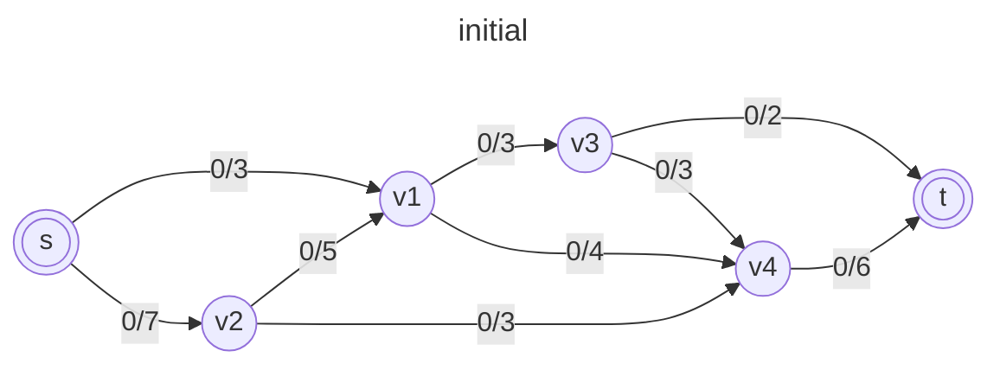
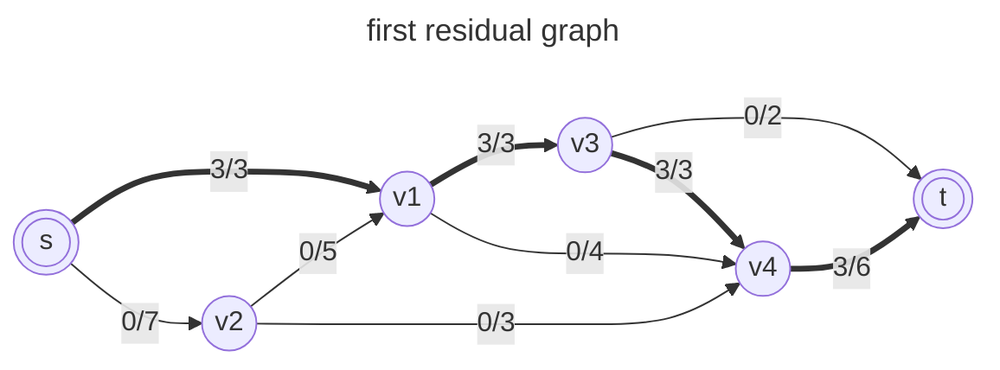
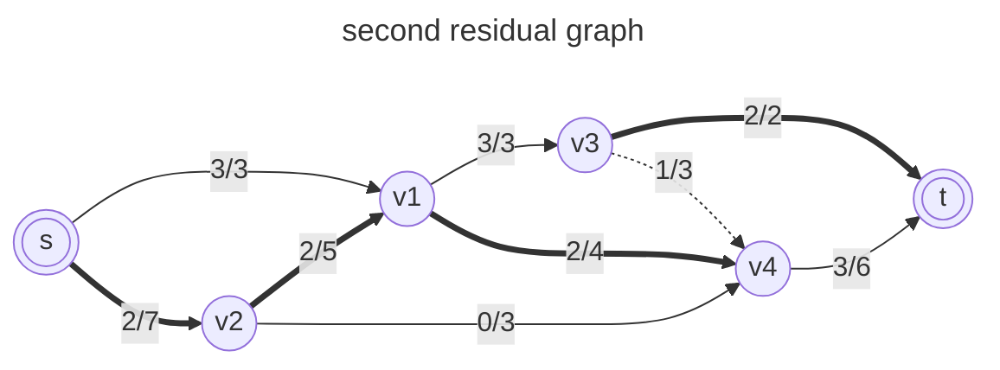
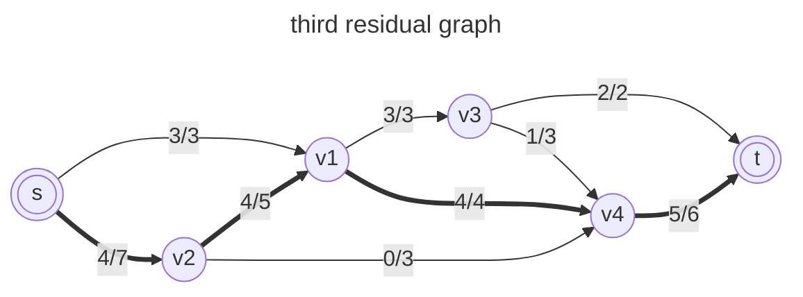
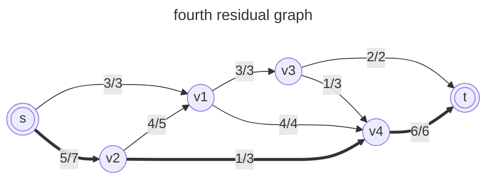

>[!problem definition]
>given a graph which represent flow network where every edge has a capacity, also given two vertices: source, sink; find out the maximum possible flow from source to sink with following constraints:
>1. **capacity constraint**: flow on an edge doesn't exceed the given capacity of edge.
>2. **flow conservation**: inflow is equal to outflow, except source and sink.
>3. **non-Negativity**: flow cannot be negative on any edge.

# terminology
## residual capacity
\~ is the original capacity of the edge, minus the the flow in that edge. The residual capacity can be seen as the leftover capacity in an edge with some flow.
## residual graph
\~ is a transformed version of the original flow network used in flow algorithms like Ford-Fulkerson to track the remaining capacities of edges, where more flow can be pushed through.
## minimum cut
the bottleneck of a network, representing the smallest total capacity of edges that, if removed, completely separate the source from the sink
## augmenting path
\~ is a path in a residual graph from the source to the sink such that every edge along the path has a positive residual capacity.
# allowed paths
1. non-full forward path
2. non-zero/non-empty backward path
<div class="page-break" style="page-break-before: always;"></div>

# properties / characteristics
- **greedy algorithm:** the algorithm is greedy in nature, as it chooses augmenting paths to increase the flow at each step.
- **termination:** the algorithm terminates when no more augmenting paths can be found in the residual graph, indicating that the maximum flow has been reached.
- **optimal solution:** the ford fulkerson algorithm guarantees that the flow obtained is the maximum possible flow for the network.
- **non-deterministic:** the algorithm does not guarantee an optimal augmenting path selection, which can affect performance in some cases. The flow found may depend on the order in which augmenting paths are chosen.
# algorithm
1. **Initialize Flow:** Start with an initial flow of 0 on all edges of the graph. Set the initial flow value on each edge to zero.
2. **Residual Graph Construction:** Construct the residual graph, which represents the remaining capacities of the edges in the network. The residual capacity of an edge is the original capacity minus the flow already sent along that edge.
3. **Find Augmenting Path:** Search for an augmenting path from the source to the sink in the residual graph. An augmenting path is a path where the residual capacity is positive for all edges along the path.
4. **Augment Flow:** Increase the flow along the found augmenting path by the minimum residual capacity of the edges in the path.
5. **Update Residual Graph:** Update the residual capacities of the edges in the augmenting path. The forward edges are reduced by the flow, and reverse edges are increased by the flow to allow for potential flow reversals in future iterations.
6. **Repeat:** Repeat the process of finding augmenting paths and updating the flow until no more augmenting paths can be found.
<div class="page-break" style="page-break-before: always;"></div>

# manual run through

---

| no  | augmenting path          | bottleneck capacity | flow |
| --- | ------------------------ | ------------------- | ---- |
| 1   | s -> v1 -> v3 -> v4 -> t | 3                   | 3    |


---

| no  | augmenting path                | bottleneck capacity | flow    |
| --- | ------------------------------ | ------------------- | ------- |
| 2   | s -> v2 -> v1 -> v4 -> v3 -> t | 2                   | 3+2 = 5 |
(v4 -> v3 is a reverse edge)

---

| no  | augmenting path          | bottleneck capacity | flow  |
| --- | ------------------------ | ------------------- | ----- |
| 3   | s -> v2 -> v1 -> v4 -> t | 2                   | 5+2=7 |

---

| no  | augmenting path    | bottleneck capacity | flow  |
| --- | ------------------ | ------------------- | ----- |
| 4   | s -> v2 -> v4 -> t | 1                   | 7+1=8 |

---
it is not possible to find a path where more flow can be sent through from `s` to `t`, which means the max flow has been found and ford fulkerson algorithm is finished.

**max flow** is 8.
<div class="page-break" style="page-break-before: always;"></div>

# implementation
```c
#include <stdio.h>

#define A 0
#define B 1
#define C 2
#define MAX_NODES 1000
#define O 1000000000

int n;
int e;
int capacity[MAX_NODES][MAX_NODES];
int flow[MAX_NODES][MAX_NODES];
int color[MAX_NODES];
int pred[MAX_NODES];

int min(int x, int y) {
  return x < y ? x : y;
}

int head, tail;
int q[MAX_NODES + 2];

void enqueue(int x) {
  q[tail] = x;
  tail++;
  color[x] = B;
}

int dequeue() {
  int x = q[head];
  head++;
  color[x] = C;
  return x;
}

// Using BFS as a searching algorithm
int bfs(int start, int target) {
  int u, v;
  for (u = 0; u < n; u++) {
    color[u] = A;
  }
  head = tail = 0;
  enqueue(start);
  pred[start] = -1;
  while (head != tail) {
    u = dequeue();
    for (v = 0; v < n; v++) {
      if (color[v] == A && capacity[u][v] - flow[u][v] > 0) {
        enqueue(v);
        pred[v] = u;
      }
    }
  }
  return color[target] == C;
}

// Applying fordfulkerson algorithm
int fordFulkerson(int source, int sink) {
  int i, j, u;
  int max_flow = 0;
  for (i = 0; i < n; i++) {
    for (j = 0; j < n; j++) {
      flow[i][j] = 0;
    }
  }

  // Updating the residual values of edges
  while (bfs(source, sink)) {
    int increment = O;
    for (u = n - 1; pred[u] >= 0; u = pred[u]) {
      increment = min(increment, capacity[pred[u]][u] - flow[pred[u]][u]);
    }
    for (u = n - 1; pred[u] >= 0; u = pred[u]) {
      flow[pred[u]][u] += increment;
      flow[u][pred[u]] -= increment;
    }
    // Adding the path flows
    max_flow += increment;
  }
  return max_flow;
}

int main() {
  for (int i = 0; i < n; i++) {
    for (int j = 0; j < n; j++) {
      capacity[i][j] = 0;
    }
  }
  n = 6;
  e = 7;

  capacity[0][1] = 8;
  capacity[0][4] = 3;
  capacity[1][2] = 9;
  capacity[2][4] = 7;
  capacity[2][5] = 2;
  capacity[3][5] = 5;
  capacity[4][2] = 7;
  capacity[4][3] = 4;

  int s = 0, t = 5;
  printf("Max Flow: %d\n", fordFulkerson(s, t));
}
```